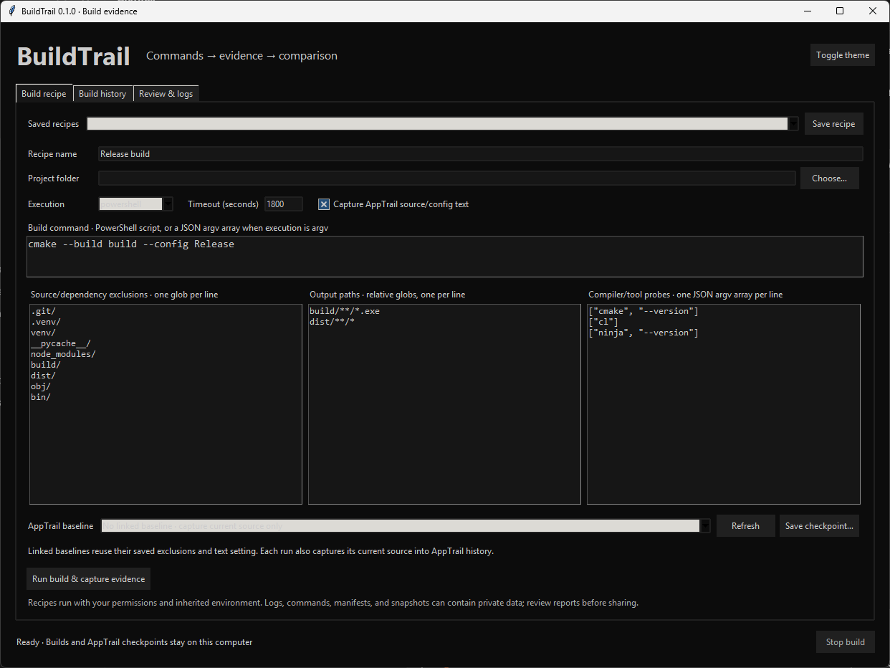
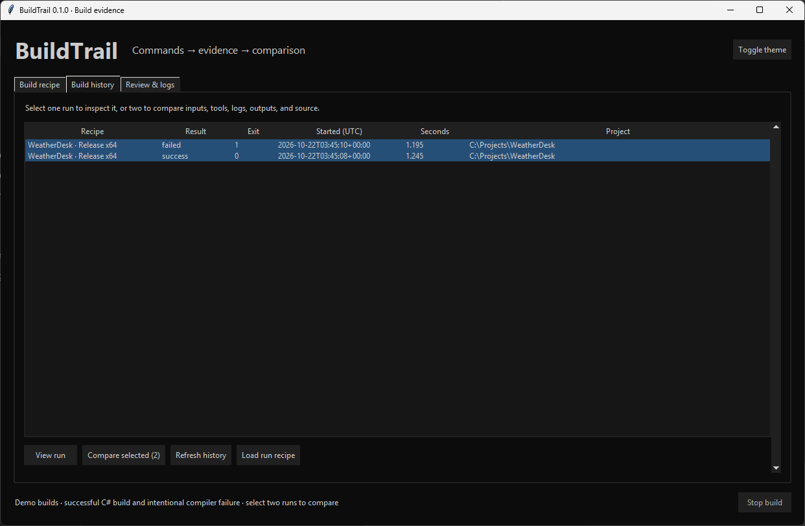
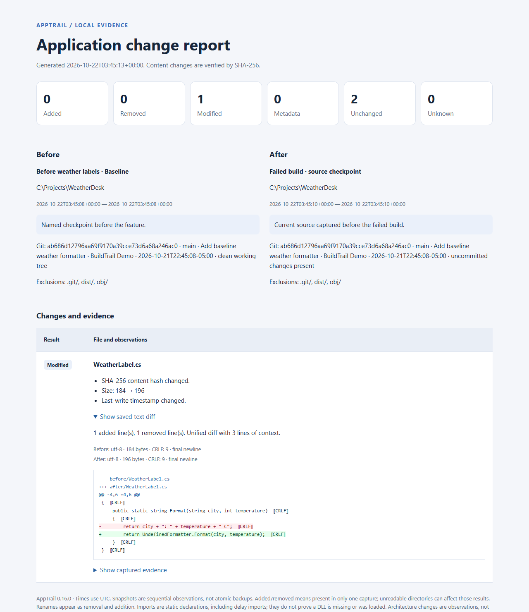

# BuildTrail

**Explain what changed between a working build and a failed one.** Save build commands, compiler/tool versions, dependency manifests, logs, output hashes, and AppTrail source checkpoints in one local history.

[Download for Windows x64](https://github.com/SeanShaffer88/BuildTrail/releases/latest) · [AppTrail](https://github.com/SeanShaffer88/AppTrail) · [Example comparison report](examples/BuildTrail-comparison.html) · [MIT license](LICENSE)

## See it in action

Configure a reusable build recipe with its command, output patterns, compiler/tool probes, source exclusions, and optional AppTrail baseline. This is the default recipe editor before a project folder is selected.



Browse saved build runs and select two to compare commands, tools, dependencies, logs, outputs, and source. The WeatherDesk demo shows a successful C# build and an intentional compiler failure, with both runs selected.



The recipe and history screenshots are unedited Windows captures supplied by Sean.

Open an AppTrail checkpoint comparison from BuildTrail to see the named baseline alongside the source captured before a failed build. The report includes Git details, file exclusions, and saved source diffs—in this example, a C# change introduces an undefined formatter.



The comparison screenshot shows the HTML report generated by BuildTrail 0.1.0 with an isolated WeatherDesk demo: one successful C# compile followed by an intentional compile failure. Project paths were normalized in the demo data before rendering. The screenshot itself is unedited.

## Run on Windows

Download **BuildTrail-0.4.0-Windows-x64.zip**, extract it, and double-click **BuildTrail.exe**. BuildTrail needs no Python installation, command window, administrator access, or account. Your compiler and build tools must already be installed. The unsigned x64 executable is validated on Windows 11 x64; other Windows versions and ARM64 have not been validated. License notices ship with the portable package.

## Capture a build

1. Choose your project folder and name the recipe, for example `Release x64`.
2. Enter the build command. Default execution is Windows PowerShell without a profile. Example: `cmake --build build --config Release`.
3. Declare **output patterns**, such as `build/**/*.exe`, `dist/**/*`, or `bin/Release/*.dll`. Paths stay relative to the project. `**/` includes zero or more directories. Matching is case-insensitive; `*` can span `/`.
4. Set **source/dependency exclusions**, one pattern per line. Defaults skip `.git`, virtual environments, `node_modules`, build outputs, `obj`, and `bin`. Names match at any depth; paths containing `/` start at the project root. These are AppTrail patterns, not `.gitignore` syntax. Symlinks and Windows reparse points are skipped.
5. Add compiler/tool probes as one JSON argument array per line: `["cl"]`, `["cmake", "--version"]`, `["dotnet", "--info"]`, or `["python", "-m", "pip", "freeze"]`. Missing tools are recorded without preventing the build.
6. Optionally choose an **AppTrail baseline**, or click **Save checkpoint…** to create one from the current recipe exclusions. Linked baselines reuse their saved exclusions and source-text setting.
7. Click **Save recipe**, then **Run build & capture evidence**. Loading a recipe does not execute it.

Each run records the recipe, command, timestamps, exit code, duration, OS/architecture, probe output and resolved executable paths, dependency manifests before/after the command, merged stdout/stderr, output hashes before/after the command, and the source snapshot captured before execution. An exit code of zero is recorded as success; correctness and output freshness remain separate evidence.

PowerShell runs with inherited environment variables and no interactive stdin. BuildTrail does not collect environment variable values, install dependencies, change Git commits, or fetch remotes itself. The command you enter can perform those operations. For native toolchains, launch from a configured environment or call a setup wrapper. Probes run **before** the build command; environment changes inside the build script do not affect earlier probes. For multiple native commands, explicitly check each exit code or use a build wrapper that does; the default PowerShell wrapper returns the last native command's exit code. Terminating PowerShell errors and ordinary nonterminating PowerShell errors fail the run.

## Compare successful and failed builds

Select two runs in **Build history** and click **Compare selected (2)**. Runs are ordered by capture time. **Review & logs** provides a quick summary; **Open full HTML review** shows:

- Before/after commands, results, timing, machine information, and warnings.
- Compiler/tool output differences, excluding irrelevant probe timing.
- Dependency-manifest hashes and bounded text diffs between build inputs; changes made by the command are also listed per run.
- Output hashes between builds and within each run. An unchanged EXE left by a failed command is labeled **Unchanged**, not newly produced.
- Saved source changes between runs and from each linked AppTrail baseline, with Git details, exclusions, capture issues, and saved text diffs.
- Captured logs and a bounded unified log comparison.

**Open AppTrail source comparison** opens the existing AppTrail report format using saved evidence. You can export a self-contained build HTML report with no scripts or network requests. Reports use the Terminal dark palette and print styling.

## Side-by-side build log review

Select two runs in **Build history** and click **Compare logs (2)**. You can also use **Side-by-side logs…** from **Review & logs** after comparing two runs. The older run is **Before** and the newer run is **After**, with each run's name, result, exit code, and capture time above its log.

The read-only panes align saved log lines, retain original line numbers, color removed/added or replaced lines, and scroll vertically together. Horizontal scrolling is independent, so you can inspect long messages. **Previous change** / **Next change** jumps between changed sections.

Search both visible logs with a literal query, optional **Match case**, and **Previous match** / **Next match**. Search supports Unicode case folding while retaining correct highlight positions. **Ctrl+F** focuses search; **F3** / **Shift+F3** moves forward/backward and wraps at the ends. Clearing the query removes its highlights.

Use **Previous issue** / **Next issue** (or **Ctrl+↑** / **Ctrl+↓**) to jump between errors and warnings, with filters for severity and **Before**, **After**, or **Both logs**. Common MSVC/C#/MSBuild, GCC/Clang, Rust, logging-level, and Python traceback/exception formats are recognized; aggregate lines such as `0 Error(s)` are ignored. Detection is heuristic, not a complete diagnostic parser or a compiler verdict. Counts apply to the visible preview, and matching lines on both sides are separate occurrences.

BuildTrail verifies each log's saved SHA-256 before displaying the same bytes. Missing or externally modified logs show an explicit failure; restore trashed runs before comparing. The viewer never executes commands or rewrites evidence. It removes terminal ANSI/control codes and normalizes line endings only for display, and uses UTF-8 replacement decoding when required. The existing theme toggle also updates open log windows.

Preview bounds keep large builds responsive: **1,000,000 decoded characters and 10,000 lines per log**, at most **20,000 characters per line**, and **2,000 search highlights** across both visible panes. The window identifies preview limits, capture truncation, and any positional alignment used for a large edited middle. Search and issue navigation cover the displayed preview; the original captured logs remain available under the run's storage directory. Existing HTML report exports retain their bounded unified log comparison; the side-by-side window can also export a separate interactive HTML log report.

## Organize build history

Select a run and click **Edit name & notes…** to give it a useful name and record test results, issue numbers, or why the build matters. Names support 1–120 characters; notes support up to 10,000 characters. Search the history filter by run name, notes, original recipe, project, date, or result. Names and notes persist across restarts and appear in build reviews and newly exported HTML reports. Renaming a run does not rename its recipe or rewrite its captured evidence.

Select one or more runs and click **Move to Trash…** to hide them from active history. Turn on **Show Trash** and use **Restore selected** to bring them back with their names and notes. Trash retains the run's files and does not free their disk space. Trashed runs must be restored before reviewing, comparing, or loading their recipes.

To reclaim space, select runs in Trash and click **Delete permanently…**. The app asks for confirmation, defaulting to No. This deletes only the selected run-owned directories—including logs, independent source/baseline copies, captured evidence, and organization details. It leaves project source, actual build outputs, saved recipes, previously exported reports, other runs, and shared AppTrail history untouched. To remove a shared source snapshot too, manage it separately in AppTrail.

BuildTrail 0.2.0 and later protect active captures with cross-window locks. Close older BuildTrail versions before organizing history, because they do not participate in those locks or understand Trash. Interrupted permanent deletions are recovered on startup: moves made before the catalog commit are restored, and committed deletions finish cleaning their staged files. Symbolic links and Windows reparse points inside deletion targets cause deletion to stop rather than traverse them.

## AppTrail integration and storage

AppTrail does not need to be installed: BuildTrail vendors the compatible MIT-licensed snapshot/history modules from AppTrail 0.16.0. Both apps use `%LOCALAPPDATA%\AppTrail\history`. Every build's pre-command source snapshot appears in AppTrail history. BuildTrail also saves independent `source.json` and optional `baseline.json` copies with the run, so deleting an AppTrail history entry does not destroy that run's evidence. Build captures do not replace your marked AppTrail baseline; **Save checkpoint…** explicitly marks the new baseline. AppTrail source comparison uses the existing saved-text limits and credential-filename exclusions.

Recipes and run evidence live in `%LOCALAPPDATA%\BuildTrail`. Each `runs/<id>/` contains `run.json`, `build.log`, tool logs, and source/baseline JSON where available. Evidence file digests detect accidental external changes; records are local files, not signed attestations. Back up both libraries while the apps are idle. Moving or replacing the executable preserves per-user history. An interrupted application can leave an **unfinished** run; it is not counted as success. There is no automatic history deletion; cleanup is explicit through Trash. Run names, notes, and Trash state are stored separately in `organization.sqlite3`. Back up the entire BuildTrail directory to retain them.

Stop/timeout closes the owned Windows Job Object, terminating its process tree; descendants are also stopped after the root command exits. Tools that require persistent background build servers or detached processes should use an in-process/no-daemon mode. Interactive prompts are unsupported. The configured timeout applies to the build command; source/hash capture and bounded tool probes add time. Cancelling capture can leave output/dependency evidence incomplete; unobserved files are not confirmed removals.

## Evidence limits

- Dependency evidence covers recognized Python, npm/pnpm/yarn, Cargo, Go, .NET/NuGet, vcpkg, Conan, CMake, and Meson manifests/lockfiles outside source exclusions. It is **not** a full installed/transitive dependency graph. Use explicit package-inventory probes when needed. Nothing is automatically resolved or downloaded.
- Dependency text: UTF-8, at most 256 KiB per file and 2 MiB per observation. Large lockfiles still retain hashes. Source text follows AppTrail's 256 KiB/3,000-line per-file and 8 MiB total budget, with credential filenames excluded.
- Merged build log: at most 10 MiB, with excess output drained and truncation recorded. Tool probes: 10 seconds and 64 KiB each. Raw captured log bytes are stored; display uses UTF-8 replacement decoding. Live log preview retains at most 200,000 characters and may omit rapid output; saved captured logs are authoritative.
- HTML previews: 200,000 characters per log, at most 300 log-diff lines, 512 KiB of source-diff text per source comparison, and 256 KiB of dependency-diff text. Limits are described in the report.
- Snapshots and hashes are sequential observations, not atomic backups. Source is captured before the command; generated source after execution is not a second source snapshot. Stable hashes identify bytes, not provenance or reproducibility. Unreadable/unstable evidence is marked or the capture stops with a recorded error.
- Commands, logs, manifests, and saved source may contain secrets or private paths. Review exports before sharing.

## Run from source or CLI

Python 3.11+ with Tk; standard library only. No pip runtime dependencies.

```powershell
python -m buildtrail
python -m buildtrail run examples/recipe.json
python -m buildtrail list
python -m buildtrail report BEFORE_ID AFTER_ID -o comparison.html
python -m buildtrail report RUN_ID -o build.html
python -m buildtrail logs BEFORE_ID AFTER_ID
python -m buildtrail --data-dir C:/BuildEvidence list
```

Edit the example recipe's project path and build command before running. CLI recipes can use `"shell": "argv"` with `"argv": ["executable", "argument"]` for direct execution without PowerShell. CLI report and log-view order follows the IDs supplied. The windowed executable also accepts these command arguments for scripted runs; it saves evidence and returns an exit status without opening a command window or printing console output.

## Build and validate

```powershell
python -m unittest discover -s tests -v
python tests/make_report_fixture.py work/report.html
# Optional browser regression: install playwright 1.62.1 in a test-only directory.
# Set BUILDTRAIL_PLAYWRIGHT to its module path, then:
node tests/report_browser.cjs work/report.html
node tests/logreport_browser.cjs work/report.logs.html
python -m pip install -r packaging/requirements-build.txt
python packaging/build_windows.py --work-dir work/package --output-dir dist/BuildTrail-Windows-x64
```

Tests cover successful/failed commands, stale output detection, linked checkpoints, independent evidence copies, exclusions, dependency changes, PowerShell exit handling, Unicode/spaced paths, cancellation, descendant cleanup, log limits, reports, the CLI, and real Tk workflows. A real MSVC consumer test runs when C++ Build Tools are available. CI tests Python 3.11/3.15 on Windows, checks the report in Edge, and builds the portable app. Automatic CI runs do not upload temporary build artifacts; manual builds retain artifacts for one day. Published downloads remain separate.

See [resource choices](docs/RESOURCE-CHOICES.md), [third-party provenance](THIRD-PARTY-NOTICES.md), and [changelog](CHANGELOG.md).

### Export side-by-side log reports

[Example interactive log report](examples/BuildTrail-log-comparison.html) — download the file and open it in your browser.

In the **Compare logs (2)** window, choose **Export HTML…**. The standalone file preserves aligned lines, change colors, original line numbers, your search text, case setting, severity/build filters and theme. It provides search across both logs, previous/next matches, errors/warnings and changes, synchronized scrolling and a theme toggle. No app, Python, server or network connection is required; JavaScript must be enabled for interactive controls.

Command line: `python -m buildtrail --data-dir LIBRARY logs BEFORE_ID AFTER_ID -o logs.html` (also supported by `BuildTrail.exe`). CLI export uses default settings and preserves the supplied build order.

Logs are verified again at export; unavailable, modified or trashed evidence cannot be exported. The same preview/alignment limits as the app apply and are stated in the report. Error/warning detection is heuristic; search covers visible log text with at most 2,000 matches. Browser case-insensitive search uses Unicode lowercasing. Reports contain captured log text and saved run names; review before sharing. The existing full build-evidence report remains available separately.
